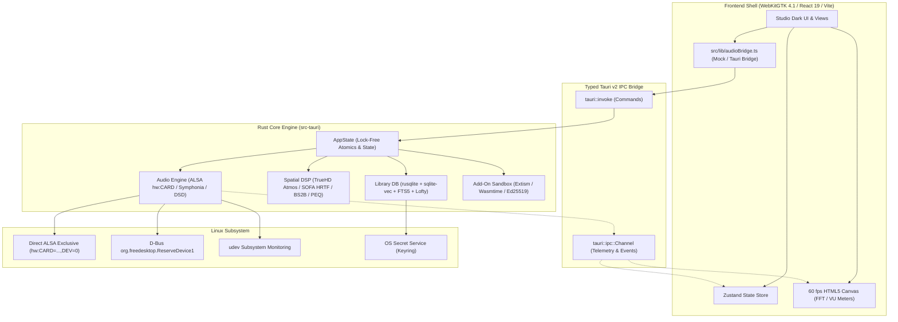

# AuraHiFi

<p align="center">
  <strong>High-Precision Linux Audiophile Music Console</strong><br>
  Bit-Perfect ALSA Hardware Transport &middot; In-Process Spatial Atmos / SOFA HRTF DSP &middot; Live 60 fps Telemetry &middot; Sandboxed WebAssembly Add-Ons
</p>

<p align="center">
  <a href="https://github.com/defiqantcoder/AuraHiFi/actions/workflows/ci.yml"></a>
  <a href="https://github.com/defiqantcoder/AuraHiFi/actions/workflows/security.yml"></a>
  
  
  
  
  
  
</p>

---

## Table of Contents

- [Overview](#overview)
- [Architecture](#architecture)
- [Key Features](#key-features)
  - [Bit-Perfect Transport & Hardware Isolation](#bit-perfect-transport--hardware-isolation)
  - [Instant Bit-Perfect &harr; Spatial Audio Switching](#instant-bit-perfect--spatial-audio-switching)
  - [In-Process SOFA HRTF & Parametric EQ](#in-process-sofa-hrtf--parametric-eq)
  - [High-Performance SQLite Library & Vector Search](#high-performance-sqlite-library--vector-search)
  - [Studio Dark UI & 60 fps Telemetry](#studio-dark-ui--60-fps-telemetry)
  - [Sandboxed WebAssembly Add-On Store](#sandboxed-webassembly-add-on-store)
- [Project Structure](#project-structure)
- [Quick Start & Development](#quick-start--development)
  - [Prerequisites](#prerequisites)
  - [Web Preview (Mock AudioBridge)](#web-preview-mock-audiobridge)
  - [Native Tauri Desktop Application](#native-tauri-desktop-application)
- [Testing & Security Audit](#testing--security-audit)
- [Typed IPC Contract](#typed-ipc-contract)
- [Engineering Invariants](#engineering-invariants)
- [Roadmap & Milestone Status](#roadmap--milestone-status)
- [Documentation & Reference](#documentation--reference)

---

## Overview

**AuraHiFi** is a precision music playback console engineered specifically for Linux desktop environments (Ubuntu 24.04 LTS Noble and Ubuntu 26.04 LTS Resolute). It combines direct ALSA hardware exclusive transport with an in-process DSP pipeline, real-time 60 fps telemetry metering, and an Extism WebAssembly extension sandbox.

Unlike conventional music players that rely on desktop sound servers to mix or resample audio, AuraHiFi negotiates direct hardware access with your DAC while remaining a cooperative desktop citizen via D-Bus device reservations.

---

## Architecture



---

## Key Features

### Bit-Perfect Transport & Hardware Isolation
- **Direct ALSA Exclusive Engine:** Addresses DACs by immutable ALSA string ID (`hw:CARD=<ID>,DEV=0`), supporting native PCM up to 384 kHz / 32-bit and native DSD (`DSD_U32_BE`) or DoP packaging.
- **Cooperative PipeWire Isolation:** Requests DAC release via D-Bus (`org.freedesktop.ReserveDevice1.Audio<N>`) without terminating or altering PipeWire services, preserving notification audio on other sinks.
- **Safe Hotplug Protection:** Real-time `udev` monitoring detects device disconnection instantly, zeroing buffers and halting playback before any audio can leak to onboard speakers.
- **Strict Bit-Perfect Honesty:** Software volume is strictly locked at `0.0 dB` during bit-perfect playback. Any DSP, resampling, or volume adjustments immediately dismiss the bit-perfect indicator in the Signal Path Inspector.

### Instant Bit-Perfect &harr; Spatial Audio Switching
- **Zero-Pop Atomic Transition:** Smooth crossfade switching between raw bit-perfect transport and the multi-channel DSP chain using a 50 ms cosine mute ramp synchronized at sample zero-crossings.
- **Dolby TrueHD Atmos:** In-process decoding with 7.1.4 spatial coordinate mapping.
- **HDMI Bitstream Passthrough:** Direct IEC 61937 / IEC 958 burst packaging for external AVR decoding.

### In-Process SOFA HRTF & Parametric EQ
- **Binaural Headphone DSP:** Realistic spatialization using SOFA HRTF impulse responses via `audionimbus` (Steam Audio) with SADIE D1 defaults.
- **Biquad Parametric EQ:** 10-band parametric equalizer supporting AutoEQ headphone compensation profiles and pre-amp gain adjustment.
- **Bauer Crossfeed (bs2b):** Stateful high-frequency spatial blend for natural headphone listening.

### High-Performance SQLite Library & Vector Search
- **Local Tag Indexing:** Fast FTS5 full-text search across local tracks, albums, and artists powered by `rusqlite` and `lofty`.
- **CUE Sheet Splitting:** Virtual track resolution from single-file album rips with millisecond accuracy.
- **Acoustic Vector Embeddings:** Integrated `sqlite-vec` indexing with `bliss-audio` acoustic features for natural language mood and vibe querying.
- **EBU R128 Loudness:** Dual track and album ReplayGain and True Peak scanning.

### Studio Dark UI & 60 fps Telemetry
- **Streamlined Precision Interface:** High-contrast, WCAG AA compliant layout styled with Tailwind CSS, Space Grotesk, Inter, and tabular JetBrains Mono figures.
- **Zero-Lag Visualizer:** 64-band FFT spectrum analyzer and true-peak stereo VU meters rendering directly to HTML5 `<canvas>` via dedicated Tauri IPC binary streaming channels.
- **Plain-Language Explanations:** Built-in interactive tooltips clarify technical audiophile terms across all screens.

### Sandboxed WebAssembly Add-On Store
- **Extism / Wasmtime Runtime:** Deny-by-default capabilities with strict memory limits, CPU fuel metering, and host function boundary checks.
- **Cryptographic Verification:** Remote modules must provide Ed25519 signatures and SHA-256 hashes against trusted keys before loading.
- **Curated Plugins:** First-party extensions for MusicBrainz metadata, AcoustID fingerprinting, Discogs releases, and LRCLIB synchronized lyrics.

---

## Project Structure

```text
AuraHiFi/
├── src/                        # React 19 + TypeScript frontend application
│   ├── components/             # Reusable UI widgets, transport controls, and canvas visualizers
│   ├── hooks/                  # Keyboard shortcut listeners and UI interaction hooks
│   ├── lib/                    # Typed AudioBridge (Mock & Tauri IPC), DSP logic, and glossary
│   ├── store/                  # Zustand global application state store
│   └── views/                  # Primary views (Now Playing, Library, Spatial, Store, Settings)
├── src-tauri/                  # Rust Tauri v2 desktop application backend
│   ├── src/
│   │   ├── addons/             # Extism WebAssembly runtime and sandbox policies
│   │   ├── audio/              # ALSA exclusive output, D-Bus reservation, and udev monitoring
│   │   ├── library/            # SQLite database, FTS5 search, and vector embeddings
│   │   ├── spatial/            # TrueHD Atmos, SOFA HRTF, bs2b, and biquad EQ filters
│   │   ├── commands.rs         # Tauri IPC command definitions
│   │   └── state.rs            # Application state management and telemetry channels
│   └── tests/                  # Security audits and sandbox constraint tests
├── addons/                     # First-party WebAssembly add-ons
│   ├── metadata-enricher/      # MusicBrainz and AcoustID metadata integration
│   ├── lyrics-art/             # LRCLIB synchronized lyrics and artwork resolution
│   └── smart-playlists/        # Hybrid vector-similarity playlist generator
├── design/                     # Authoritative AuraHiFi Studio Dark design system
├── plan/                       # Architecture specification and milestone tracking
├── agents/                     # Contributor rules and engineering invariants
└── .github/workflows/          # CI and security audit workflows
```

---

## Quick Start & Development

### Prerequisites

- **Node.js** (v20+ or v22+) or **Bun**
- **Rust** (stable toolchain, 1.85+)
- **Linux System Packages** (Ubuntu 24.04 / 26.04):
  ```bash
  sudo apt-get update && sudo apt-get install -y \
    build-essential \
    pkg-config \
    libwebkit2gtk-4.1-dev \
    libasound2-dev \
    libudev-dev \
    libdbus-1-dev
  ```

### Web Preview (Mock AudioBridge)

Develop and test the frontend interface with simulated audio playback and telemetry without requiring native ALSA access:

```bash
# Install dependencies
npm install

# Start Vite development server
npm run dev
```

Visit `http://localhost:3000` in your browser.

### Native Tauri Desktop Application

Launch the complete desktop application with native hardware integration:

```bash
# Run in desktop development mode
npm run tauri dev

# Package a release .deb installer
npm run tauri build -- --bundles deb
```

---

## Testing & Security Audit

AuraHiFi maintains a strict suite of unit, integration, and security audit tests.

```bash
# Run all workspace unit and integration tests
cargo test --workspace

# Run Extism WebAssembly sandbox adversarial security tests
cargo test --test addon_sandbox_security

# Run Tauri IPC boundary and permission security audits
cargo test --test tauri_security_audit

# Strict TypeScript typechecking
npm run typecheck

# Production frontend asset bundle
npm run build
```

---

## Typed IPC Contract

Communication between the UI and Rust backend is fully typed via [`src/lib/audioBridge.ts`](src/lib/audioBridge.ts):

| Command / Channel | Category | Description |
| :--- | :--- | :--- |
| `list_audio_devices` | Hardware | Enumerates available sound cards, supported rates, and DAC types |
| `select_audio_device` | Hardware | Acquires D-Bus exclusive reservation and opens ALSA transport |
| `test_dac_capabilities` | Diagnostics | Probes hardware sample rates, bit depths, and DSD capabilities |
| `set_audio_mode` | Playback | Switches between `bit_perfect` transport and `spatial` DSP mode |
| `update_spatial_config` | DSP | Adjusts SOFA HRTF positions, bs2b presets, and 10-band PEQ curves |
| `transport_command` | Playback | Dispatches play, pause, seek, track skip, and volume changes |
| `scan_library` | Library | Asynchronously indexes selected local music folders |
| `list_store_addons` | Add-Ons | Lists installed and available WebAssembly modules |
| `install_addon` | Add-Ons | Verifies Ed25519 signature and registers add-on permissions |
| `subscribe_telemetry` | Channel | 60 fps streaming binary channel for FFT bands and VU levels |
| `subscribe_hardware_events` | Channel | Real-time notifications for DAC connection and rate updates |

---

## Engineering Invariants

1. **Real-Time Audio Safety:** Audio playback runs on an isolated thread promoted via RTKit. The output thread performs zero heap allocations, zero blocking disk/network I/O, and zero mutex locks.
2. **Signal Path Honesty:** The Bit-Perfect indicator is only displayed when audio is delivered bit-for-bit unchanged at `0.0 dB` software volume. Any active processing immediately reflects in telemetry.
3. **Cooperative System Behavior:** Hardware reservation uses standard desktop D-Bus interfaces (`ReserveDevice1`). System services like PipeWire are never forcibly killed or altered.
4. **Deterministic Sandboxing:** WebAssembly extensions execute within restricted Extism sandboxes with bounded memory, CPU fuel constraints, and explicit user-approved host permissions.

---

## Roadmap & Milestone Status

- [x] **Phase 1 — UI & Mock Bridge:** Studio Dark design system, responsive multi-view console, 60 fps `<canvas>` FFT/VU meters, and MockAudioBridge.
- [x] **Phase 2 — Tauri v2 Shell & Bit-Perfect Core:** Direct ALSA hardware exclusive mode (`hw:CARD=...`), D-Bus `ReserveDevice1` integration, and safe pause-on-unplug.
- [x] **Phase 3 — Spatial Audio, Atmos & Headphone DSP:** 50 ms cosine pop-free atomic mode switch, TrueHD Atmos decoding, SOFA HRTF binaural rendering, and biquad PEQ.
- [x] **Phase 4 — SQLite Library, Folder Picker & First-Run Setup:** Local SQLite metadata database, CUE sheet splitting, EBU R128 loudness analysis, and native folder selection.
- [x] **Phase 4.5 — Plain-Language Tooltips & Keyring Integration:** Universal hover glossary, OS keyring secret storage, and hybrid AI smart playlist UI.
- [x] **Phase 5 — Extism Add-On Store & First-Party Plugins:** Deny-by-default Wasm sandbox, cryptographic signature verification, and first-party add-on modules.
- [x] **Phase 6 — Single-Install Packaging & System Verification:** Ubuntu 24.04 and 26.04 packaging, WebKitGTK 4.1 validation, and bit-perfect hardware verification.
- [x] **Phase 7 — Security Testing & CI/CD Pipelines:** Automated cargo-deny license checks, adversarial sandbox security tests, and GitHub Actions CI workflows.

---

## Documentation & Reference

- [Design System Guide (`design/DESIGN.md`)](design/DESIGN.md) &mdash; Studio Dark UI color tokens, typography, and contrast rules.
- [Implementation Plan (`plan/PLAN.md`)](plan/PLAN.md) &mdash; Full architectural specifications and SQLite schema details.
- [Agent & Architecture Invariants (`agents/AGENTS.md`)](agents/AGENTS.md) &mdash; Workspace guidelines and audio thread constraints.
- **Domain Rules:** [Rust Audio Engine](agents/rules/rust-audio-engine.md) &middot; [Frontend UI](agents/rules/frontend-ui.md) &middot; [Add-On Security](agents/rules/addon-security.md)
