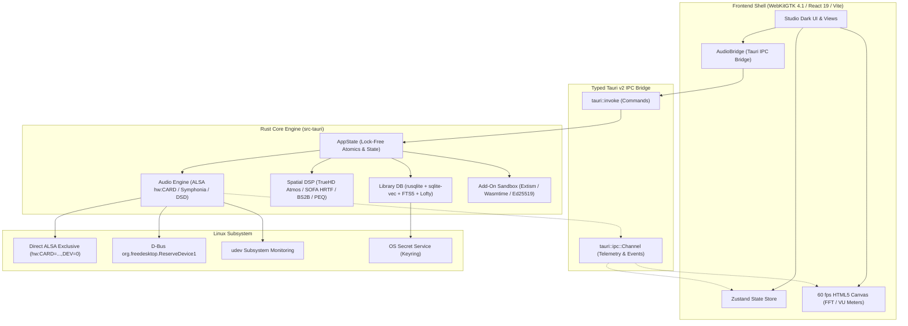

# AuraHiFi

<p align="center">
  <strong>High-Precision Linux Audiophile Music Console</strong><br>
  Bit-Perfect ALSA Hardware Transport &middot; In-Process Spatial Atmos / SOFA HRTF DSP &middot; Live 60 fps Telemetry &middot; Sandboxed WebAssembly Add-Ons
</p>

<p align="center">
  <a href="https://github.com/defiqantcoder/AuraHiFi/actions/workflows/ci.yml"></a>
  <a href="https://github.com/defiqantcoder/AuraHiFi/actions/workflows/security.yml"></a>
  
  
  
  
  
  
</p>

---

## Installation

### Option 1: Install Debian Package (.deb) on Ubuntu 24.04 / 26.04 LTS

1. Download the latest `.deb` release package from [GitHub Releases](https://github.com/defiqantcoder/AuraHiFi/releases):
```bash
wget https://github.com/defiqantcoder/AuraHiFi/releases/download/v0.1.1/AuraHiFi_0.1.1_amd64.deb
```

2. Install the package with `apt` (automatically resolving dependencies):
```bash
sudo apt-get update && sudo apt-get install -y ./AuraHiFi_0.1.1_amd64.deb
```

3. Launch AuraHiFi from your desktop application launcher or via terminal:
```bash
aurahifi
```

### Option 2: Build and Install from Source

```bash
# Clone the repository
git clone https://github.com/defiqantcoder/AuraHiFi.git
cd AuraHiFi

# Install required system packages
sudo apt-get update && sudo apt-get install -y \
  build-essential \
  pkg-config \
  libwebkit2gtk-4.1-dev \
  libasound2-dev \
  libudev-dev \
  libdbus-1-dev

# Install dependencies and build frontend
npm install
npm run build

# Compile the release .deb package
npx tauri build --bundles deb

# Install the built package
sudo apt-get install -y src-tauri/target/release/bundle/deb/AuraHiFi_*.deb
```

---

## Architecture

AuraHiFi couples a responsive React 19 / WebKitGTK frontend with a low-latency, real-time Rust audio engine on Tauri v2.



### Architectural Breakdown

- **Direct ALSA Exclusive Transport (`src-tauri/src/audio`)**: Communicates directly with hardware DACs via immutable ALSA identifier strings (`hw:CARD=...,DEV=0`), isolating playback from desktop mixing servers. Acquires exclusive device access via D-Bus `org.freedesktop.ReserveDevice1` without interrupting desktop audio daemons on other sinks.
- **In-Process Spatial DSP Engine (`src-tauri/src/spatial`)**: Multi-channel processing engine integrating Dolby TrueHD Atmos frame decoding, SOFA HRTF binaural headphone rendering, 10-band parametric EQ, and Bauer crossfeed (bs2b). Performs atomic transitions between bit-perfect direct transport and spatial DSP chains using a 50 ms cosine mute ramp synchronized at sample zero-crossings.
- **High-Performance Music Database (`src-tauri/src/library`)**: SQLite database with SQLite-vec acoustic embeddings, FTS5 full-text search, CUE sheet parsing, and EBU R128 loudness analysis.
- **Extism WebAssembly Add-On Sandbox (`src-tauri/src/addons`)**: Deny-by-default execution environment for third-party extensions. Modules execute inside isolated Wasmtime runtimes constrained by memory bounds, CPU fuel metering, host boundary validation, and cryptographic Ed25519 signature checks.
- **Hardware-Accelerated UI (`src`)**: React 19 interface rendered through WebKitGTK. Real-time 60 fps telemetry streams (64-band FFT spectrum analyzer and stereo true-peak VU meters) are rendered onto an HTML5 canvas via direct binary IPC channels.

---

## Features

### Bit-Perfect ALSA Hardware Transport
- **Direct Hardware Exclusive Mode**: Delivers unadulterated PCM (up to 384 kHz / 32-bit) and native DSD (`DSD_U32_BE`) or DoP packaging straight to external DACs via dedicated hardware addresses (`hw:CARD=<ID>,DEV=0`).
- **Cooperative PipeWire / PulseAudio Reservation**: Utilizes standard D-Bus `ReserveDevice1` negotiation so system notifications remain active on other devices while AuraHiFi operates exclusively on your primary audiophile DAC.
- **Safe Hotplug Protection**: Real-time `udev` monitoring detects DAC disconnections instantly, immediately clearing buffers and pausing transport to prevent audio leakage to onboard speakers.
- **Signal Path Honesty Invariant**: Software volume is strictly locked at `0.0 dB` during bit-perfect playback. Any DSP, resampling, or volume adjustments immediately dismiss the BIT-PERFECT badge in the Signal Path Inspector.

### In-Process Spatial Audio & Headphone DSP
- **Dolby TrueHD Atmos Decoding**: 7.1.4 spatial coordinate decoding and downmixing, with direct HDMI IEC 61937 / IEC 958 bitstream passthrough for external AV receivers.
- **SOFA HRTF Binaural Rendering**: Realistic three-dimensional spatial staging for headphones using Head-Related Transfer Functions (defaulting to SADIE D1 impulse response measurements).
- **10-Band Parametric Equalizer**: Biquad PEQ filter bank supporting AutoEQ headphone profiles and customizable pre-amp gain.
- **Bauer Crossfeed (bs2b)**: Natural analog speaker acoustic simulation on stereo headphones, eliminating listening fatigue from aggressively separated stereo mixes.
- **Zero-Pop Atomic Mode Switching**: Seamless switching between bit-perfect direct transport and spatial DSP chains with a 50 ms cosine mute ramp.

### Library Management & Acoustic Search
- **High-Speed FTS5 Search**: Sub-millisecond queries across tracks, albums, artists, and genres via indexed SQLite full-text search.
- **CUE Sheet Splitting**: Automatic virtual track splitting for single-file lossless album image rips with millisecond cue accuracy.
- **Vector-Similarity Acoustic Search**: Integrated `sqlite-vec` vector database with `bliss-audio` acoustic features for natural vibe, tempo, and mood matching.
- **EBU R128 Loudness Normalization**: Comprehensive integrated LUFS and true-peak analysis for track and album ReplayGain tags.

### Studio Dark Telemetry UI
- **60 fps Canvas Visualizer**: Low-overhead real-time 64-band FFT spectrum analyzer and calibrated stereo VU meter powered by direct binary IPC streams.
- **Interactive Signal Path Inspector**: Visual inspection of every stage in the audio pipeline from source file decode through DSP to DAC output.
- **Plain-Language Glossary**: Built-in hover explanations for complex audiophile and technical concepts (DoP, HRTF, DSD, LUFS, WASI, etc.).

### Sandboxed WebAssembly Add-Ons
- **Extism / Wasmtime Plugin Architecture**: Extends player functionality safely without granting native OS access.
- **Cryptographic Verification**: Requires Ed25519 digital signatures and SHA-256 verification against trusted keys before loading any plugin.
- **Bundled First-Party Add-Ons**:
  - *Metadata Enricher*: Automated MusicBrainz tag resolution and AcoustID fingerprint matching with token-bucket rate limiting.
  - *Lyrics & Artwork*: Synchronized time-stamped lyrics from LRCLIB and album artwork retrieval.
  - *Smart Playlists*: Hybrid acoustic-similarity and metadata-driven playlist generation.

---

## Future Add-Ons

AuraHiFi's sandboxed add-on architecture is engineered for modular expansion. Upcoming extensions in development include:

### 1. Listen Together (Mini-Chat & Synchronized Music Room)
A real-time, low-latency collaborative listening room enabling users to stream and listen to high-fidelity audio together synchronously:
- **Sample-Accurate Clock Synchronization**: Sub-millisecond synchronized playback across networked AuraHiFi clients with automatic jitter compensation.
- **Integrated In-App Mini-Chat**: A collapsible chat drawer within the player to discuss tracks, share timestamped reactions, and talk with friends while listening.
- **Collaborative DJ Session**: Shared session queues with host privileges, guest queue requests, and vote-skip capabilities.

### 2. Music Casting
Lossless and high-resolution networked audio streaming from AuraHiFi's bit-perfect engine to external network speakers, receivers, and remote devices:
- **Lossless Network Endpoints**: Bit-perfect streaming over local Wi-Fi / Ethernet to dedicated streamers, UPnP/DLNA renderers, and remote PipeWire/Linux nodes.
- **Multi-Protocol Casting**: Modular support for major network casting standards, including AirPlay 2, Google Cast / Chromecast Audio, and DLNA/UPnP.
- **Synchronized Multi-Room Zones**: Independent or grouped playback zones with per-device volume offset and DSP profile preservation.
